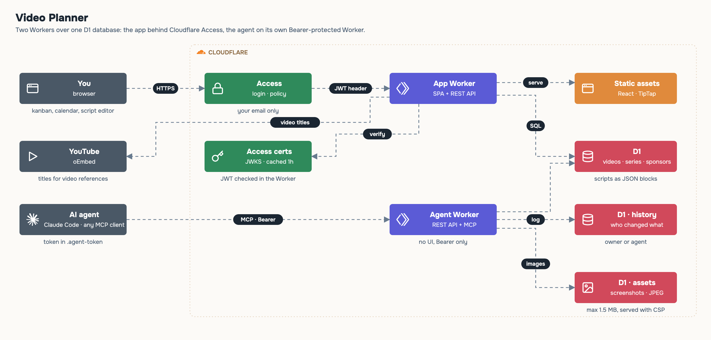

# Architecture: low-level design



<sub>Source: <a href="docs/architecture/draw.py">docs/architecture/draw.py</a>. README images: <a href="docs/assets/build.py">docs/assets/build.py</a>.</sub>

```
browser ── Cloudflare Access ──► video-planner (Worker)
                                   ├─ static assets: React SPA (Vite)
                                   └─ /api/*  REST (Hono)
AI agent ── Bearer ─────────────► video-planner-agent (Worker)
                                   └─ /api/* + /mcp (JSON-RPC, Streamable HTTP)
both ──► D1 (SQLite): videos, series, sponsors, history, assets
```

| Component | Decision | Why |
|---|---|---|
| One Worker for SPA + API | `@cloudflare/vite-plugin`, `run_worker_first` for `/api/*` and `/mcp` | One deploy, no CORS, no Pages project. |
| D1 | Single SQLite database | One user, low write volume; free tier is plenty. |
| Script as JSON blocks | `videos.script` holds `pairs`, `hook`, `conteudo`, `insercao`, `conclusao` (or `capa`, `gancho` for reels); `PATCH` merges one level deep | The agent edits one block without overwriting the rest. |
| Per-block versions | `script_blocks` (video_id, block) holds `version` + `prev` (previous value). Writes take an optional `base_version` and are applied in one D1 batch (conditional version bump + `json_set` of the block); a mismatch returns 409 with the current value. Block names are an allow-list per format (`SCRIPT_BLOCKS`). | Owner and agent can't silently overwrite each other; `prev` is the base for showing what changed. |
| Text as markdown | TipTap in the browser, markdown in the database | The agent reads and writes plain text; the UI renders it live. |
| Images in D1 | Resized to JPEG in the browser (≤1600 px), stored as BLOB in `assets` | No R2 bucket to set up; screenshots are small. |
| Auth for people | Cloudflare Access in front; the Worker verifies the JWT against the team's certs | Zero login code; defense in depth if a route ever bypasses Access. |
| Auth for agents | Separate Worker outside Access, `Authorization: Bearer AGENT_TOKEN`, constant-time compare | Agents can't do an interactive login. A second Worker keeps the human app fully behind Access. |
| Fail closed | No secrets set = `401`; dev opens only with `DEV_OPEN=1` on `localhost` | A fresh deploy is never open to the internet. |
| History | Every update stores actor (`owner` / `agente`), action and previous value | See what the agent changed; undo by hand. |

## Data notes

- Stored values stay in Portuguese (statuses `Ideias`, `Esse mês`, `Produzindo`, `Editando`, `Finalizado`, `Cancelados`; formats `longo`, `vertical`; script blocks `conteudo`, `insercao`…). The UI translates them on display (`src/i18n.ts`), so switching `LOCALE` never touches data.
- Agents get the same names through MCP; tool descriptions explain them in English.
