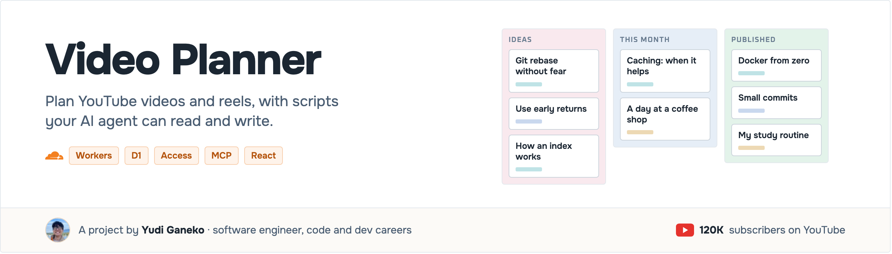
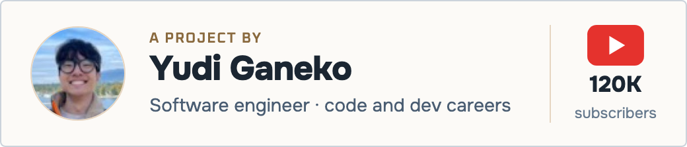
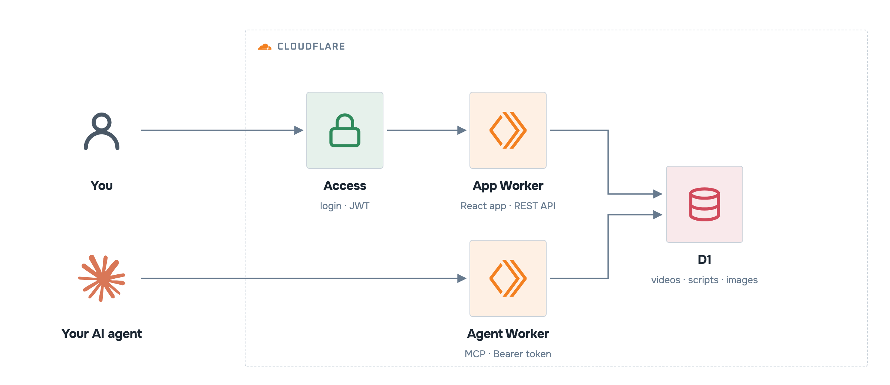
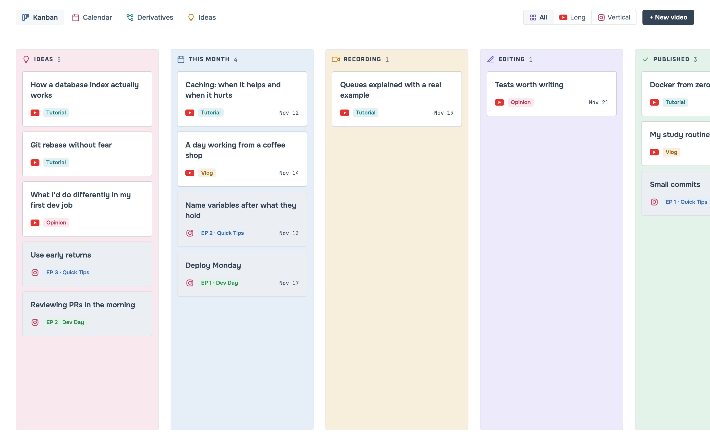
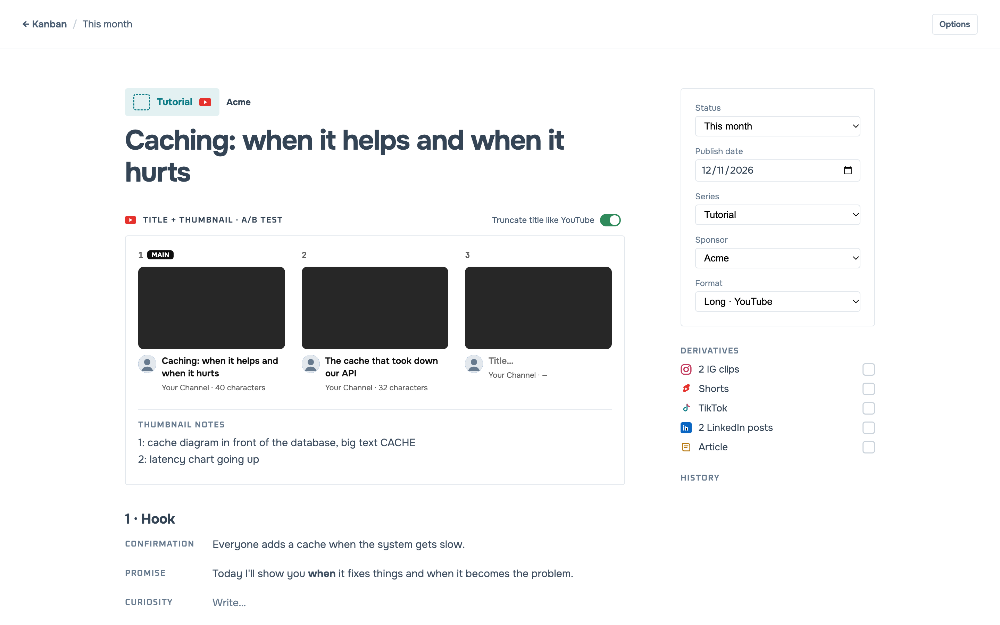
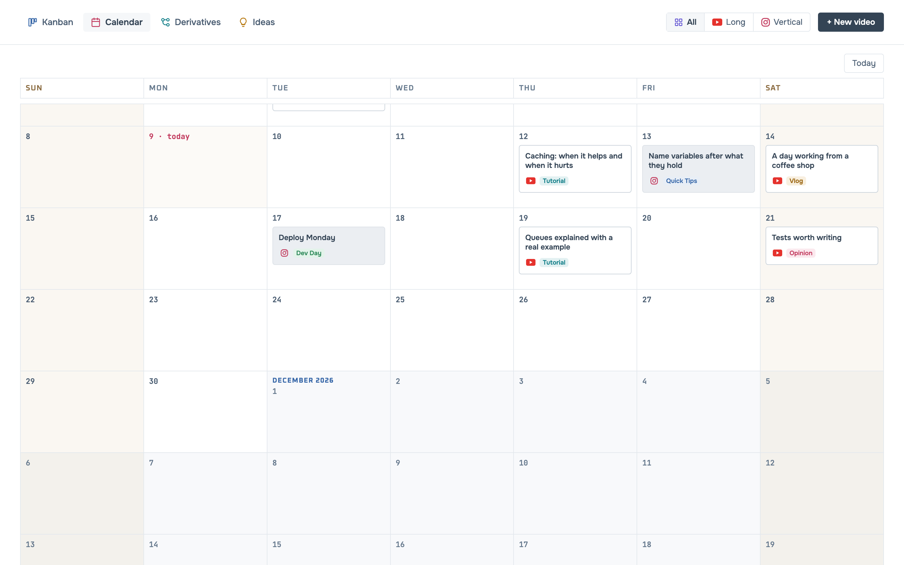
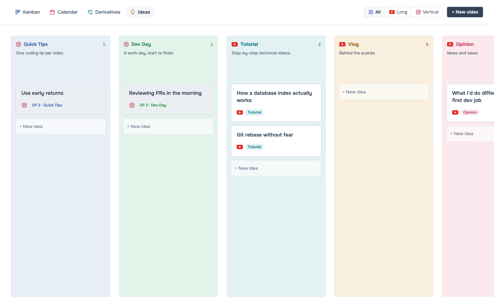

<p align="center"></p>

<p align="center">    <a href="LICENSE"></a></p>

<p align="center"><a href="https://www.youtube.com/@yudiganeko"></a></p>

**A planner for YouTube videos and reels**: a kanban, a calendar and a Notion-like script editor, in one Cloudflare Worker. Your AI agent gets the same powers through MCP: it lists videos, writes a script block without touching the others, moves cards. Free tier friendly. The UI is in English, with Brazilian Portuguese available (`LOCALE=pt-BR`).

<p align="center"></p>

<p align="center"><sub>A simplified view. Every component, with the decision behind it: <a href="ARCHITECTURE.md">ARCHITECTURE.md</a>.</sub></p>

## What's inside

| Kanban | Script |
|---|---|
|  |  |
| **Calendar** | **Ideas by series** |
|  |  |

- **Kanban** by status, drag to reorder or move. **Calendar** with infinite scroll; drag a card to a day to schedule it.
- **Script** in blocks: 3 title + thumbnail pairs (A/B test, YouTube-style preview), hook, content, sponsor insertion, conclusion. Reels get a cover and the series' opening and closing lines (`This is episode {ep} of…`).
- **Editor**: live markdown (headings, lists, checklists, quotes), paste screenshots, YouTube links become small reference cards.
- **Derivatives**: track cuts, Shorts, TikTok, LinkedIn posts per published video.
- **History**: every change records who made it (you or the agent).

## Deploy your own

Needs a Cloudflare account (the free plan is enough), Node 20+ and git.

```sh
git clone https://github.com/YudiG12/video-planner && cd video-planner
npm ci && npx wrangler login
npm run setup
```

`setup` creates the D1 database, applies the migrations, deploys both Workers and saves the agent token in `.agent-token` (git-ignored).

Or ask your AI coding agent:

```txt
Clone https://github.com/YudiG12/video-planner and deploy it for me, following its AGENTS.md.
```

### Protect the app with Cloudflare Access

Until you do this, the app answers `401` to everyone (only the agent's token works).

1. Cloudflare dashboard → **Workers & Pages → video-planner → Access → Protect this Worker behind Access**, scope **All traffic**, with a policy that allows only you.
2. Copy the application's **AUD tag** and your team domain (`<team>.cloudflareaccess.com`), then:

```sh
echo "<team>.cloudflareaccess.com" | npx wrangler secret put ACCESS_TEAM_DOMAIN
echo "<AUD tag>" | npx wrangler secret put ACCESS_AUD
```

The Worker verifies the Access JWT (signature, audience, issuer, expiry) on every request.

### Make it yours

```sh
echo "Your Channel" | npx wrangler secret put CHANNEL_NAME     # shown in the YouTube preview
echo "yourhandle"   | npx wrangler secret put CHANNEL_HANDLE   # shown on reel covers
echo "https://…/me.jpg" | npx wrangler secret put AVATAR_URL
echo "pt-BR"        | npx wrangler secret put LOCALE         # optional: Portuguese UI
```

Series and sponsors live in D1. Edit `migrations/0001_init.sql` before the first deploy, or later:

```sh
npx wrangler d1 execute video-planner --remote --command \
  "INSERT INTO series (id,name,format,color,bg,description,position) VALUES ('live','Live','longo','#3767A8','#E8EEF6','Weekly live',10)"
```

## How to use with your agent

```sh
claude mcp add --transport http video-planner \
  https://video-planner-agent.<your-subdomain>.workers.dev/mcp \
  --header "Authorization: Bearer $(cat .agent-token)"
```

Then ask:

```
What's planned for this month?
Write the hook for the cache video.
Create 3 reel ideas for the "Quick Tips" series, each with the next episode number.
```

Tools: `list_videos`, `get_video`, `create_video`, `update_video`, `move_video`, `update_script_block`, `list_series`, `next_episode`.

## Run locally

```sh
npm ci
echo "DEV_OPEN=1" > .dev.vars   # open on localhost only, never set this in production
npm run db:migrate:local && npm run db:seed:demo
npm run dev
```

## Links

- [ARCHITECTURE.md](ARCHITECTURE.md): components and decisions
- [Security](SECURITY.md) · [MIT license](LICENSE)
